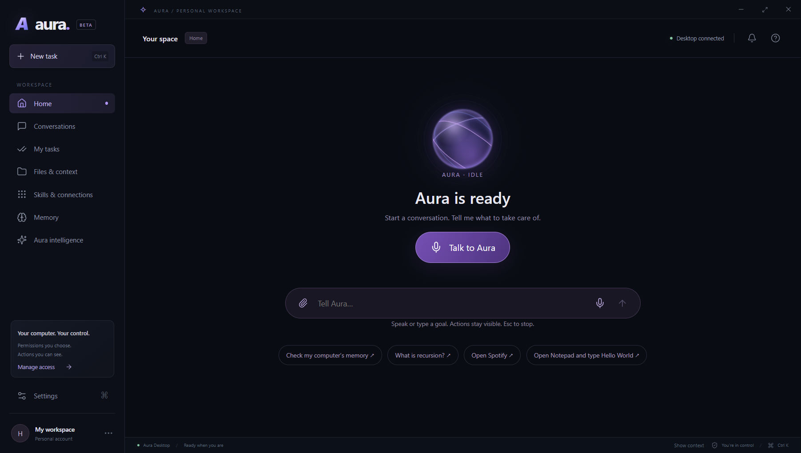
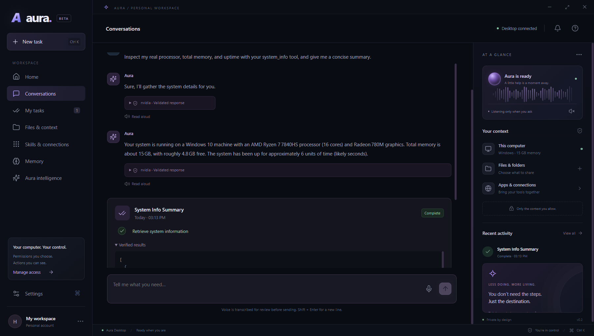
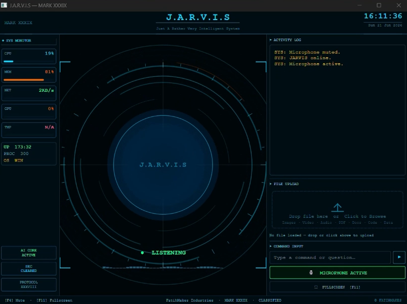
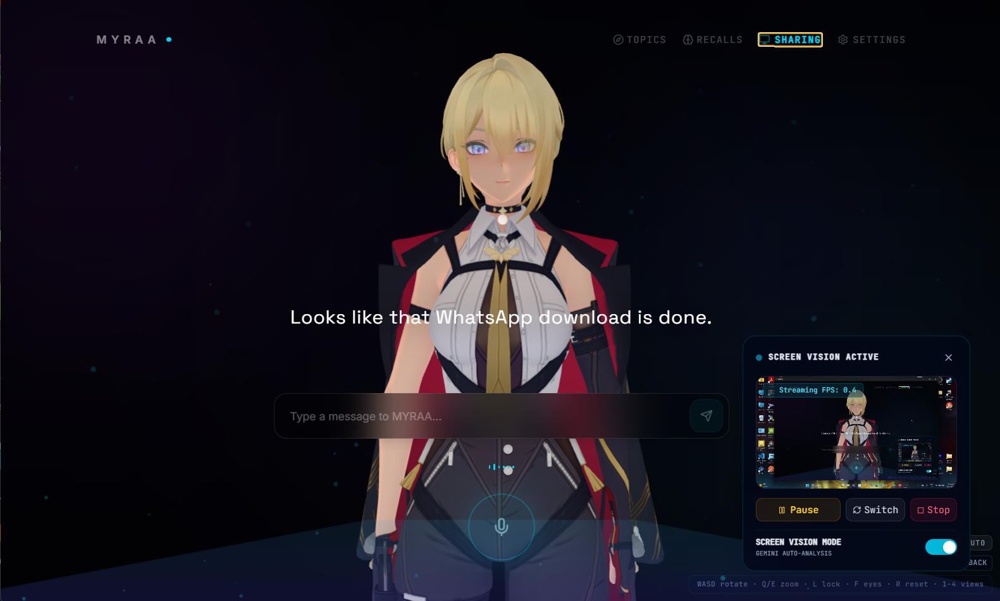

# Aura / LUNA — Phase 2 progress

Source: the supplied 15-slide Phase 2 progress presentation. Status statements below are presentation-reported progress, not fresh benchmarks.

## Goal and architecture

Understand voice/text requests, route them to file/browser/application capabilities, execute through controlled tools, and observe results. Known commands use deterministic tools; ambiguous tasks use an optional LLM planner followed by validated execution.

## Reported MVP progress

- File operations: create, search, read, move, recycle and organize supported content.
- Browser: public-page navigation and visible text/link/table extraction; complex authenticated actions remain pending.
- Applications: discovery, launch, window/control and desktop-action experiments.
- Voice and memory: tested or explored in separate prototypes.
- UI: visible plans, action progress, reviewed actions and task state.
- Unified assistant: still in progress; useful prototype modules need integration into a stable runtime.

The document-classification experiment uses extraction/OCR, MiniLM embeddings and subject-vector comparison. It is supporting LUNA-side prototype work, not a claim that every component is integrated into this repository.

## What we learned

Provider latency, quotas and local-model tool-call reliability shaped the architecture. Stable tool contracts, path validation, verification and clear runtime boundaries matter more than model selection alone. Future work includes a common capability registry, shared memory/logs, better perception, permissions and undo/rollback.

## Prototype gallery

### Aura desktop interface

### ARIA experiment

The captured session includes an unsuccessful restore response, illustrating the need for stronger verification and recovery.

### Earlier JARVIS / Mark XXXIX reference

User-supplied screenshot of an earlier Mark variant. This is a journey/reference image, not a screenshot labelled as the Mark LI source in another repository. FatihMakes attribution is visible in the original interface.

### MYRAA prototype

## Contribution and source clarity

Team: Prateek Sharma, Dhruv Singh, Dhruv Saini. Guide: Dr. Kushagra Agarwal. LUNA references, Mark/FatihMakes study material, PyAGI experiments and development harnesses are supporting work; their presence is not a claim of original authorship over upstream implementations.
